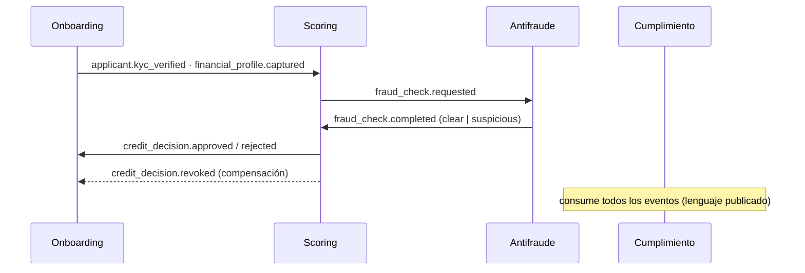

# ADR 0004: Persistencia, broker de eventos y patrones de datos

**Fecha:** 2026-10-01 (revisado y argumentado el 2026-10-15)  
**Estado:** Aceptado  
**Relacionado con:** [ADR 0002](0002-estilo-arquitectonico.md), [ADR 0003](0003-cloud-style.md), [bounded contexts](../data/bounded-contexts.md), [catálogo de eventos](../data/event-catalog.md), [DER](../data/der.png)

> Revisión del 2026-10-15: se argumenta cada decisión contra los atributos de calidad, los escenarios HU1–HU5 y el contrato de la API, y se alinea con los ADR 0002 y 0003. Los motores, el broker y los patrones no cambian. Se explicita el alcance del Outbox, la idempotencia en dos niveles y el comportamiento ante fallos.

## Contexto

Con los bounded contexts explícitos, falta decidir el motor de persistencia de cada uno, el broker de eventos y qué patrones de datos aplicar.

**Ya decidido y no se reabre aquí:**
* [ADR 0002](0002-estilo-arquitectonico.md): microservicios orientados a eventos con Apache Kafka. El ADR 0002 deja a este ADR la semántica de entrega y la idempotencia.
* [ADR 0003](0003-cloud-style.md): AWS; Fargate para Onboarding, Scoring y Fraude; Lambda para consumidores asíncronos; Aurora PostgreSQL Serverless v2 y MSK Serverless; equipo sin SRE 24/7. El ADR 0003 delega a este ADR "los motores de datos de cada contexto".
* Cuatro contextos, uno por servicio, que no se llaman de forma síncrona entre sí ([context map](../data/bounded-contexts.md)).

**Drivers de la decisión.** Cada argumento de este ADR remite a uno o más de ellos:

| ID | Driver | Fuente |
| :-- | :--- | :--- |
| **D1** | Decisión de crédito < 60 s (p95). El `POST` responde `received` al instante; la decisión es asíncrona. | [Atributos de calidad](../arch/atributos-calidad.md) #1, `api/openapi.yaml` |
| **D2** | Propagación de alertas de fraude < 500 ms. | Atributos de calidad #1, HU3 |
| **D3** | Idempotencia: reintentos sin duplicar solicitudes ni evaluaciones. | Atributos de calidad #2, HU5 |
| **D4** | Registro inmutable de cada decisión para la CMF. | Atributos de calidad #3, HU4 |
| **D5** | Equidad y reproducibilidad: la API no acepta género ni comuna y el modelo no los usa; cada decisión debe poder reconstruirse con su `model_version`. | Atributos de calidad #3, `api/openapi.yaml`, `scoring.completed` |
| **D6** | Capacidad operativa: equipo de 6 personas, sin SRE 24/7. | ADR 0003 |
| **D7** | Integridad referencial en el núcleo transaccional de crédito. | [DER](../data/der.puml) de Scoring |

**Evidencia del repositorio que condiciona la decisión:**
* El catálogo de eventos ya fija el sobre común (`event_id`, `aggregate_id` como clave de partición, `trace_id`) y la entrega *at-least-once*.
* El servicio mínimo del lab S07 (`src/main.py`) guarda las solicitudes en memoria por réplica, y `k8s/hpa.yaml` fija un mínimo de 3 réplicas: un reintento que cae en otra réplica no encuentra la clave de idempotencia. Es un placeholder, pero muestra por qué la clave debe vivir en un almacén compartido y transaccional.

## Decisión

### 1. Principios

* Cada contexto es dueño exclusivo de sus datos. Ningún contexto lee la base de otro; se integran solo por eventos.
* **Redis nunca es fuente de verdad.** Lo que debe sobrevivir a una pérdida de Redis vive en Aurora, Neptune o S3.
* Un motor adicional se acepta solo si el patrón de acceso del contexto lo exige y existe como servicio gestionado (D6). De los 5 motores, Aurora, S3 y OpenSearch ya figuran en el ADR 0003 (base relacional, artefactos y logs); los nuevos son Redis y Neptune.

### 2. Motor por contexto

| Contexto | Motores | Drivers |
| :--- | :--- | :--- |
| **Onboarding / Identidad** | Aurora PostgreSQL + Redis | D3, D7 |
| **Scoring / Riesgo** | Aurora PostgreSQL (escritura) + OpenSearch (lectura) | D1, D3, D5, D7 |
| **Antifraude** | Amazon Neptune + Redis | D2 |
| **Cumplimiento / Auditoría** | OpenSearch + S3 | D4, D5 |

**Onboarding / Identidad: Aurora PostgreSQL + Redis.** El agregado `Applicant` (RUT validado, KYC, consentimiento) guarda datos personales con invariantes que no pueden romperse: una identidad verificada por solicitante, unicidad del RUT. Eso pide transacciones ACID, claves foráneas y restricciones `UNIQUE` (D7). Redis guarda sesión y OTP, que son efímeros por naturaleza: no vale la pena pagar durabilidad por datos que expiran en minutos.

**Scoring / Riesgo: Aurora PostgreSQL (escritura) + OpenSearch (lectura).** El DER del contexto (`CreditApplication`, `ScoringResult`, `FinancialProfile`, `DecisionRecord`, `ManualReview`) es relacional con claves foráneas, y el camino crítico de la decisión (D1) lee y escribe solo contra Aurora. La clave de idempotencia se guarda en la misma transacción que la solicitud (HU5, [trazabilidad](../arch/trazabilidad-backlog-contenedor.md)), cosa que solo un motor transaccional garantiza (D3). El dashboard del analista hace consultas de otra naturaleza (filtros por estado, categoría de riesgo, versión de modelo y quién decidió; búsqueda en motivos y notas de revisión) que competirían con la carga transaccional: se resuelven en OpenSearch sobre una proyección. Guardar `model_version` junto a cada puntaje permite reconstruir la decisión (D5). El estado de las revisiones manuales pendientes (HU2: modelo sin respuesta en más de 5 s) vive en Aurora, no en la cola de Redis.

**Antifraude: Amazon Neptune + Redis.** Las señales de fraude son relaciones entre entidades: `fraud_check.requested` trae `device_id`, `ip_country` y `applicant_id`, y el valor está en conectar solicitantes distintos que comparten dispositivo o identidad. Son consultas de varios saltos, cuyo costo en un modelo relacional crece con la profundidad (joins en cadena o CTE recursivas), mientras que un grafo recorre relaciones de forma nativa, lo que importa para D2. Redis lleva los contadores de velocidad: el caso borde de HU3 (la cuarta solicitud de un dispositivo en menos de 1 hora) es un conteo en ventana de tiempo, no un recorrido de grafo, y Redis lo resuelve con lecturas de submilisegundo y expiración natural. Neptune es el motor del ADR 0004 frente a "Neo4j / Neptune" que aún aparece en el C4 L2 y en `managed-services.md`.

**Cumplimiento / Auditoría: OpenSearch + S3.** El requisito (D4) es doble y ningún motor único lo cubre: *inmutabilidad* y *búsqueda*. El registro de cada decisión se archiva en S3 con Object Lock (modo WORM), de modo que nadie, tampoco un administrador, lo altere durante la retención. OpenSearch no es fuente de verdad: es un índice reconstruible desde S3, que sirve a auditores y analistas (por ejemplo, la etiqueta "Re-evaluación CMF" de HU4) y que el ADR 0003 ya incluye para logs. CloudWatch Logs aporta los logs estructurados con `trace_id`; el registro por decisión, inmutable, vive en S3.

### 3. Broker: Amazon MSK Serverless (Kafka gestionado)

Entrega *at-least-once*, consumidores idempotentes por `event_id` y particionado por `aggregate_id`, de modo que los eventos de una misma solicitud se procesan en orden. El flujo de crédito atraviesa los 4 contextos exclusivamente por eventos.

Por qué Kafka en esta forma, más allá de que el ADR 0002 ya lo eligió:

* **Log retenido y reproducible.** Permite reconstruir la proyección de OpenSearch, y Cumplimiento consume los 16 eventos del catálogo "tal cual" sin pedir cambios a los productores (D4, D5). Una cola tradicional borra el mensaje al consumirlo.
* **Orden por agregado.** Scoring y Antifraude necesitan ver los eventos de una solicitud en secuencia.
* **Consumidores independientes.** El catálogo muestra hasta cuatro consumidores por evento; cada uno usa su propio *consumer group* sin acoplarse al resto.
* **Latencia de milisegundos**, compatible con D2 (ver presupuesto), y **serverless** porque el equipo no tiene SRE (D6).

**Presupuesto para D2 (supuesto de diseño, a validar con prueba de carga).** Se mide desde que el evento de entrada se publica en Kafka hasta que `fraud_alert.raised` llega al backoffice:

| Tramo | Presupuesto |
| :--- | :-: |
| Entrega del evento de entrada a Antifraude | ≤ 50 ms |
| Evaluación de reglas (Redis) y consulta de grafo (Neptune) | ≤ 250 ms |
| Publicación de `fraud_alert.raised` | ≤ 50 ms |
| Entrega al backoffice | ≤ 100 ms |
| Margen | ≈ 50 ms |
| **Total** | **< 500 ms** |

La latencia del relay del Outbox en el productor (Scoring) queda fuera de ese tramo; su mecanismo (sondeo corto o CDC) se define al implementar. Para D1, Kafka no es el cuello de botella: el presupuesto de 60 s lo consumen el bureau, la validación KYC y el modelo.

### 4. Idempotencia en dos niveles (D3)

**Nivel 1: API.** Todo `POST` exige `Idempotency-Key` (contrato OpenAPI). En Aurora se guarda la clave junto con un hash del cuerpo, en la misma transacción que la solicitud: mismo cuerpo devuelve la respuesta original con `Idempotent-Replayed: true`; distinto cuerpo devuelve `409`; la respuesta se conserva 24 h. Se usa Aurora y no Redis porque la clave y la solicitud deben confirmarse de forma atómica: con Redis, un fallo entre ambas escrituras deja una clave sin solicitud o una solicitud sin clave, y el siguiente reintento duplica.

**Nivel 2: eventos.** Cada consumidor descarta los `event_id` ya procesados, según su motor:

| Consumidor | Mecanismo |
| :--- | :--- |
| Aurora (Onboarding, Scoring) | Tabla `processed_events`, en la misma transacción que aplica el efecto. |
| Neptune (Antifraude) | Escrituras *upsert* con identificadores deterministas (por ejemplo, `fraud_case_id` derivado de `application_id`). |
| Redis (contadores de velocidad) | Conjunto ordenado por dispositivo con `application_id` como miembro y la hora como puntaje, en lugar de `INCR`: reprocesar un evento no suma dos veces, y la ventana de 1 hora sale del propio puntaje. |
| S3 (Cumplimiento) | Clave determinista por `event_id` con escritura condicional (solo si no existe). |
| Webhook al partner | El contrato exige al receptor ser idempotente por `event_id`. |

Un contador `INCR` sería incorrecto bajo *at-least-once*: un evento reprocesado inflaría el conteo y produciría falsos positivos, como suspender la cuenta en la tercera solicitud en lugar de la cuarta.

### 5. Patrones

| Patrón | ¿Se aplica? | Dónde y por qué |
| :--- | :-: | :--- |
| **Outbox** | Sí | Onboarding y Scoring guardan el evento en una tabla outbox dentro de la misma transacción que el dato; un relay lo publica después a Kafka. Así no se pierde el evento si el broker cae justo después del commit. |
| **CQRS** | Sí | Scoring separa físicamente la escritura (Aurora) de la lectura (OpenSearch) para el dashboard de analistas. |
| **Saga por coreografía** | Sí | El flujo de crédito cruza los 4 contextos sin 2PC, con compensaciones como `credit_decision.revoked`. |
| **Event Sourcing** | Solo en Cumplimiento | Es el único contexto que exige el historial completo; en los demás, la complejidad del *replay* no se justifica. |

**Outbox.** Guardar un dato y publicar un evento son dos escrituras en sistemas distintos sin transacción común: sin Outbox, un fallo entre ambas deja un dato sin evento y el flujo de crédito queda inconsistente. Se aplica en Onboarding y Scoring porque son los contextos cuyos eventos nacen de un cambio de estado en una base transaccional (una solicitud nueva, una decisión). **Antifraude y Cumplimiento no lo usan:** sus eventos (`fraud_check.completed`, `fraud_alert.raised`, `audit_record.logged`) son la respuesta a un evento de entrada, y para ellos basta el esquema consumir-procesar-publicar: el offset se confirma solo después de publicar, y si el consumidor cae en medio, reprocesa y vuelve a publicar con un `event_id` determinista (por ejemplo, UUID v5 del `event_id` de entrada y el tipo de evento), que los consumidores aguas abajo descartan por el nivel 2.

**CQRS.** Las cargas son incompatibles: transacciones cortas y consistentes frente a consultas variables del analista. La proyección se alimenta de los eventos de Scoring desde Kafka. El costo es consistencia eventual: el dashboard puede ir segundos por detrás, lo que es aceptable porque el analista revisa casos ya decididos; la decisión misma se lee siempre de Aurora.

**Saga por coreografía.** Cruza 4 contextos con bases distintas; el commit en dos fases no es soportado por Neptune ni OpenSearch y acoplaría la disponibilidad. Coreografía y no orquestación porque el estilo ya es orientado a eventos (ADR 0002), no se suma un componente central que operar (D6) y los contextos quedan desacoplados.

**Event Sourcing (solo Cumplimiento).** Es el único contexto cuyo requisito *es* el historial completo y ordenado: no importa el estado actual de una solicitud, importa demostrar qué se decidió, con qué datos y con qué modelo (D4, D5). En los demás contextos se consulta el estado actual, y el costo del patrón (versionado de eventos, *replay*, curva de aprendizaje) no se paga con ningún beneficio. Los eventos evolucionan con `event_version` según la [política de versionado](../api/versioning-policy.md).

### 6. Comportamiento ante fallos

| Falla | Comportamiento | Fuente |
| :--- | :--- | :--- |
| Lista negra o grafo inaccesible | La transacción queda "En pausa por seguridad" y se notifica al oficial de fraude (no se aprueba sin señal). | HU3, caso de error |
| Redis caído (contadores de velocidad) | Se trata igual: sin señal de velocidad no se aprueba automáticamente. *Extensión de HU3; confirmar con el equipo.* | HU3 |
| Modelo sin respuesta en más de 5 s | La solicitud pasa a la cola de revisión manual (estado en Aurora). | HU2, caso de error |
| Kafka no disponible | La API sigue aceptando solicitudes (`received`) y el Outbox acumula eventos hasta recuperarse; la decisión se retrasa. | OpenAPI (asincronía), Outbox |
| OpenSearch caído | Solo se degrada el dashboard; las decisiones no se ven afectadas y la proyección se pone al día al reconectar. | CQRS |

## Consecuencias

### Positivas
* **Motor:** cada contexto usa el motor que calza con su patrón de acceso real.
* **Trazabilidad:** Cumplimiento obtiene una auditoría inmutable y reproducible para la CMF (D4, D5).
* **Idempotencia de extremo a extremo:** clave de API en Aurora y deduplicación por `event_id` en cada consumidor (D3).
* **Camino crítico simple:** la decisión de crédito (D1) lee y escribe solo contra Aurora; el resto reacciona por eventos.
* **Desacople:** un consumidor nuevo (por ejemplo, un monitor de equidad) no exige tocar a los productores.

### Negativas y riesgos

| Riesgo | Mitigación |
| :--- | :--- |
| **Operación:** 5 motores más Kafka para un equipo de 6 (D6). | Todos son servicios gestionados; solo Redis y Neptune son nuevos respecto del ADR 0003; infraestructura como código (Terraform). |
| **Neptune es la justificación más débil para un MVP:** el payload actual aporta `device_id` e `ip_country`, pocas dimensiones relacionales. | Validar con casos reales de fraude; si no se justifica, replegar a PostgreSQL (ver criterios de revisión). |
| **Consistencia eventual** entre Aurora y OpenSearch. | La decisión nunca se lee de OpenSearch; monitorear el *lag* de la proyección. |
| **Debugging distribuido** en la saga por coreografía. | `trace_id` en cada evento, en el `X-Trace-Id` de la API y en los logs; catálogo de eventos mantenido; *dead-letter topic* con alertas. |
| **Duplicados** por *at-least-once* y por reproceso de consumidores. | Idempotencia en dos niveles (sección 4) y `event_id` determinista en eventos derivados. |
| **Datos personales** replicados en Aurora, OpenSearch y S3. | Publicar en eventos solo lo necesario (por ejemplo, `rut_hash`, no el RUT) y cifrar en reposo. |
| **Pérdida de la cola de pendientes en Redis.** | Es una vista derivada; el estado pendiente vive en Aurora y se reconstruye desde ahí. |

## Alternativas descartadas

* **Un único PostgreSQL para todo:** simplifica la operación, pero Antifraude necesita recorridos de grafo y Cumplimiento necesita búsqueda e inmutabilidad real; además el dashboard competiría con la carga transaccional.
* **Grafo sobre PostgreSQL en lugar de Neptune:** la alternativa más seria para el MVP y reduce un motor. Se descarta porque las consultas de varios saltos escalan peor y D2 es una restricción dura; queda como plan de repliegue.
* **Neo4j autogestionado:** operar el clúster sin SRE contradice la regla del ADR 0003 ("sábado a las 3 PM"). Se cierra en Neptune, gestionado en AWS.
* **Publicar en Kafka desde el servicio tras el commit (doble escritura):** si el proceso cae entre ambos pasos se pierde el evento; es exactamente el fallo que el Outbox evita.
* **Commit en dos fases (2PC/XA) entre contextos:** acopla disponibilidad, y Neptune y OpenSearch no participan en él.
* **Saga orquestada con Temporal:** un componente más que operar sin SRE 24/7 (D6) y acoplamiento al orquestador.
* **Saga orquestada con un servicio gestionado (por ejemplo, AWS Step Functions):** resuelve la operación, pero lleva la lógica del flujo a un orquestador central, contra el estilo del ADR 0002. Es la opción a reevaluar si la coreografía resulta inmanejable.
* **SNS + SQS:** gestionado y simple, pero no conserva un log reproducible (no se pueden reconstruir proyecciones ni dar de alta consumidores con historia) y el orden por clave exige colas FIFO con límites de throughput.
* **Amazon EventBridge:** sin orden garantizado por clave y con latencia menos predecible frente al presupuesto de 500 ms.
* **Kinesis Data Streams:** alternativa válida con semántica similar. Se mantiene Kafka porque el ADR 0002 ya lo fijó y por el ecosistema (consumer groups, herramientas de Outbox y CDC), sin atar el diseño a una API propietaria.
* **Event Sourcing en todos los contextos:** *replay* y curva de aprendizaje sin beneficio fuera de Cumplimiento.
* **MongoDB para Scoring:** el núcleo de crédito necesita integridad referencial y joins (D7).
* **DynamoDB para Onboarding o Scoring:** el ADR 0003 ya lo descartó para el core de créditos; la unicidad compuesta y las claves foráneas son más naturales en PostgreSQL.
* **Redis para la clave de idempotencia de la API:** no se confirma de forma atómica con la solicitud (ver sección 4).

## Criterios de revisión

Este ADR debe reabrirse si ocurre alguno de estos casos:

1. Las pruebas de carga no sostienen D2 (< 500 ms) con el relay y el broker elegidos, o MSK Serverless no ofrece la retención necesaria para reconstruir proyecciones.
2. Las consultas de Antifraude resultan resolubles en PostgreSQL dentro de D2, lo que haría innecesario Neptune.
3. El equipo no puede sostener la operación de los motores (D6) y se requiere consolidar.
4. El seguimiento de la saga por coreografía resulta inviable (incidentes sin causa trazable), lo que justificaría una orquestación gestionada.

## Acciones derivadas

* Actualizar el [C4 L2](../c4/l2-container.png) y [`managed-services.md`](../arch/managed-services.md): "Neo4j / Neptune" pasa a Neptune.
* Agregar al [DER](../data/der.puml) las tablas `outbox`, `processed_events` e `idempotency_keys`, que hoy no aparecen.
* Aclarar en el ADR 0003 que la "validación síncrona de Fraude" en Fargate significa contenedor siempre encendido (sin *cold start*), no una llamada directa desde Scoring, que el context map prohíbe.
* Reemplazar el almacén en memoria de `src/main.py` por Aurora antes de escalar réplicas (ya anotado como limitación en el propio archivo).
