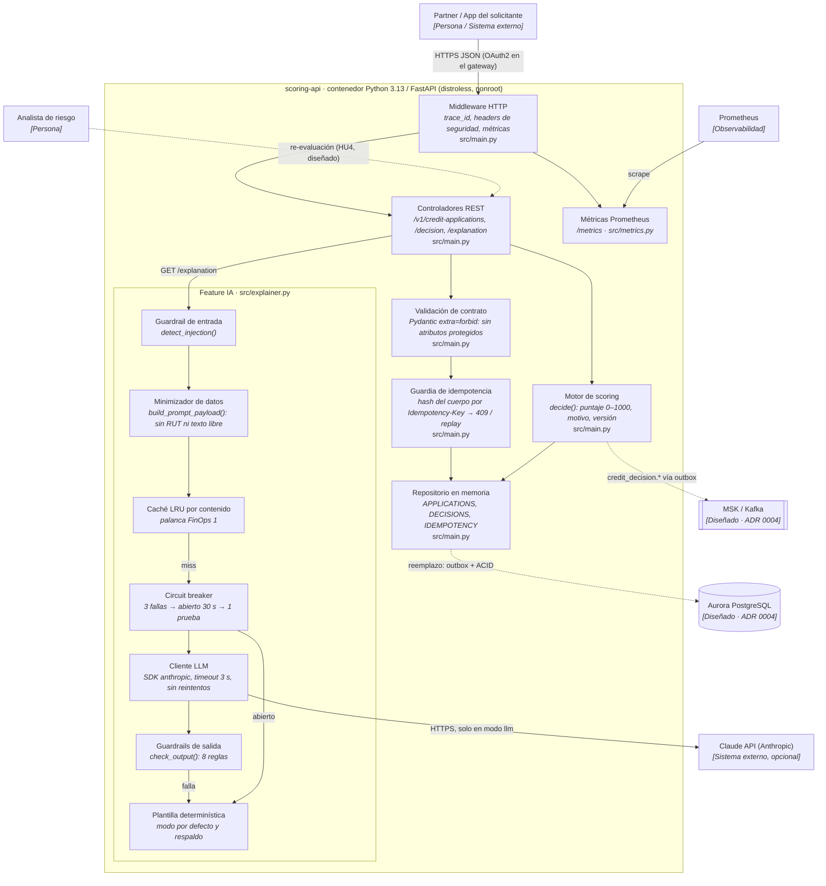

# C4 Nivel 3 — Componentes de `scoring-api`

Completa los niveles 1 ([contexto](l1-context.png)) y 2 ([contenedores](l2-container.png)). Muestra lo que existe en el código hoy (`src/`) y marca con línea punteada lo diseñado que todavía no está implementado.

## Componentes y decisiones que los justifican

| Componente | Responsabilidad | ADR | Test que falla si se rompe |
| :--- | :--- | :--- | :--- |
| Guardia de idempotencia | Mismo cuerpo + misma clave → misma respuesta; otro cuerpo → 409 | [0004](../adr/0004-datos-y-eventos.md) | `test_idempotencia_misma_key_otro_cuerpo_da_409` |
| Validación de contrato | Rechaza campos fuera del contrato (género, comuna) | [0002](../adr/0002-estilo-arquitectonico.md) | `test_contrato_rechaza_atributos_protegidos` |
| Motor de scoring | Regla fija hoy; modelo supervisado en el diseño | [0004](../adr/0004-datos-y-eventos.md) | `test_reglas_de_scoring` |
| Repositorio en memoria | Placeholder de Aurora: **riesgo técnico número 1** | [0009](../adr/0009-resiliencia-degradacion.md) | game day E2 (pérdida medida) |
| Minimizador de datos | El LLM no ve datos personales | [0008](../adr/0008-feature-ia-explicador.md) | `test_el_prompt_nunca_lleva_rut_ni_texto_libre` |
| Guardrails de salida | Coherencia, PII, atributos protegidos, promesas, fuga | [0008](../adr/0008-feature-ia-explicador.md) | `test_guardrail_detecta_cada_violacion` (8 casos) + red team |
| Circuit breaker | No golpear a un proveedor caído | [0009](../adr/0009-resiliencia-degradacion.md) | `test_semiabierto_deja_pasar_una_sola_prueba` |
| Caché | No pagar dos veces el mismo texto | [0010](../adr/0010-finops.md) | `test_cache_evita_segunda_llamada_y_cuenta_costo` |
| Métricas | SLIs de los SLOs | [0009](../adr/0009-resiliencia-degradacion.md) | `test_metrics_expone_contadores` |

**Por qué todo vive en un solo proceso:** el servicio tiene un solo bounded context (scoring) y un equipo chico. Separar el explicador en otro microservicio sumaría red, un contrato y un despliegue más, sin una necesidad de escalado distinta. Si el explicador llegara a usar GPU o a escalar distinto, se separa: el componente ya tiene una interfaz pequeña (`Explainer.explain(decision, application)`).
