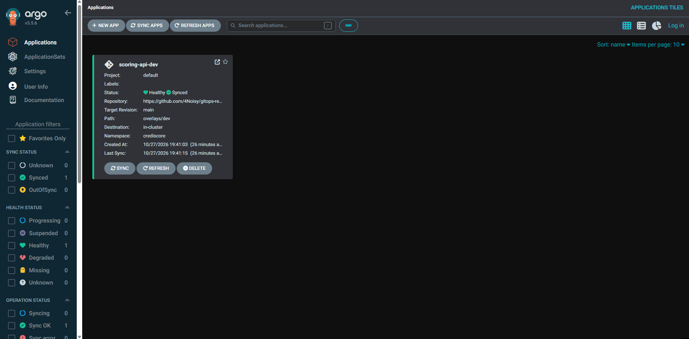
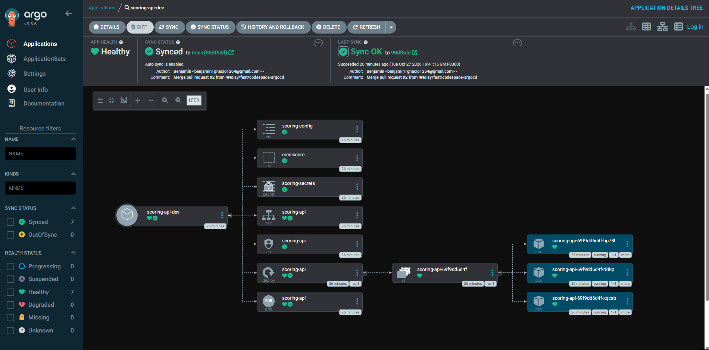

# Evidencia S08 — CI/CD y GitOps

Flujo completo: un merge a `main` del repo app corre el CI, publica la imagen y la promueve a [`4Noisy/gitops-repo`](https://github.com/4Noisy/gitops-repo), que Argo CD sincroniza en el cluster. La decisión está en el [ADR 0005](../adr/0005-gitops-strategy.md).

## Rúbrica

| Criterio | Evidencia | Estado |
| :--- | :--- | :-: |
| Pipeline con jobs y gates | [Run de `main`](https://github.com/4Noisy/-equipo-lospapus--crediscore-/actions/runs/40590244032): `quality` → `build-and-push` → `promote`, los tres en verde. Gates en [`ci.yml`](../../.github/workflows/ci.yml): ruff (lint y formato), bandit (SAST), pip-audit (SCA) y Trivy. | ✅ |
| Cobertura de tests ≥ 70 % | Paso "Tests con cobertura" de la misma run: `--cov=src --cov-fail-under=70`. | ✅ |
| Publicación de imagen automatizada | [`ghcr.io/4noisy/scoring-api:487cef4d2db95238c6185519240835121e4001f2`](https://github.com/4Noisy/-equipo-lospapus--crediscore-/pkgs/container/scoring-api), pública y con el tag igual al SHA del commit. | ✅ |
| Repo GitOps con `base/` y `overlays/{dev,prod}` | [`4Noisy/gitops-repo`](https://github.com/4Noisy/gitops-repo). Cada cambio lo valida el workflow `validate` (`kustomize` + `kubeconform`). | ✅ |
| Promoción automática a dev | [Commit del bot](https://github.com/4Noisy/gitops-repo/commit/546d0840f7fbd9658e734c2ceb1ebdb282c3ff78) `chore(dev): scoring-api -> 487cef4`, con [validación en verde](https://github.com/4Noisy/gitops-repo/actions/runs/40593624024). | ✅ |
| Promoción a prod por PR revisado | [PR #1 en `gitops-repo`](https://github.com/4Noisy/gitops-repo/pull/1), abierto solo por el CI, con [validación en verde](https://github.com/4Noisy/gitops-repo/actions/runs/40593637077). | ✅ |
| Argo CD Synced/Healthy | [Aplicación](argocd-synced.png): `scoring-api-dev` en **Healthy / Synced**, desde `gitops-repo`, rama `main`, `overlays/dev`. [Árbol de recursos](argocd-arbol.png): los 7 recursos en Healthy y 3 pods en `running`, sincronizado a `main` (`90df5dd`). | ✅ |
| ADR 0005 | [`docs/adr/0005-gitops-strategy.md`](../adr/0005-gitops-strategy.md) | ✅ |

## Argo CD





Se levantó en un GitHub Codespace de `gitops-repo` con `bash scripts/argocd-up.sh`. Los pasos manuales equivalentes, en un cluster local (Docker Desktop con Kubernetes activado), desde una copia de `gitops-repo`:

```bash
kubectl create namespace argocd
kubectl apply -n argocd -f https://raw.githubusercontent.com/argoproj/argo-cd/stable/manifests/install.yaml
kubectl apply -f argocd/application.yaml
kubectl port-forward svc/argocd-server -n argocd 8443:443
```

Abrir `https://localhost:8443` con el usuario `admin` y esta contraseña:

```bash
kubectl -n argocd get secret argocd-initial-admin-secret -o jsonpath="{.data.password}" | base64 -d
```

La app `scoring-api-dev` debe quedar **Synced / Healthy**.
